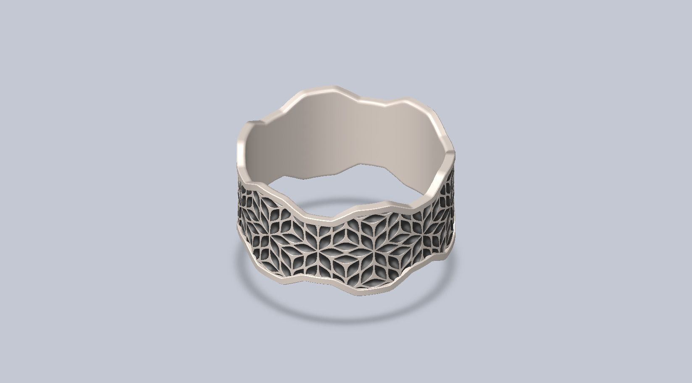
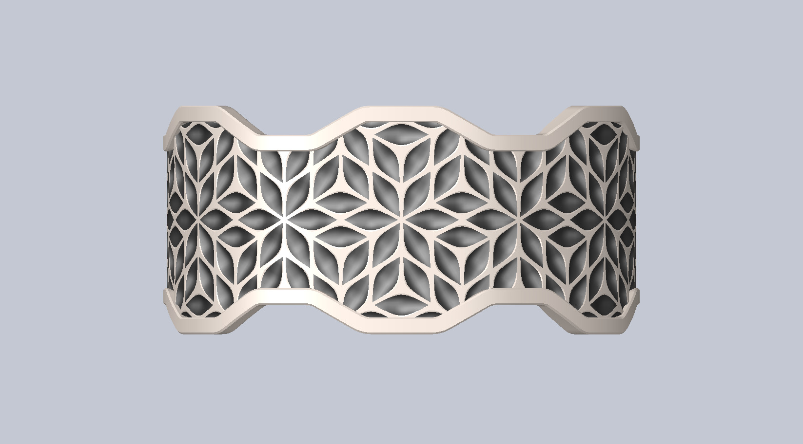
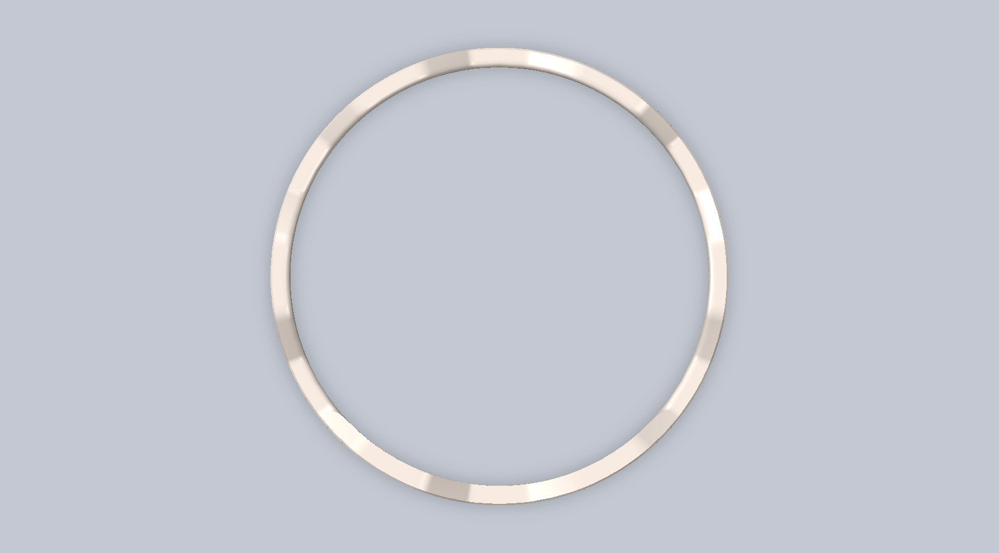
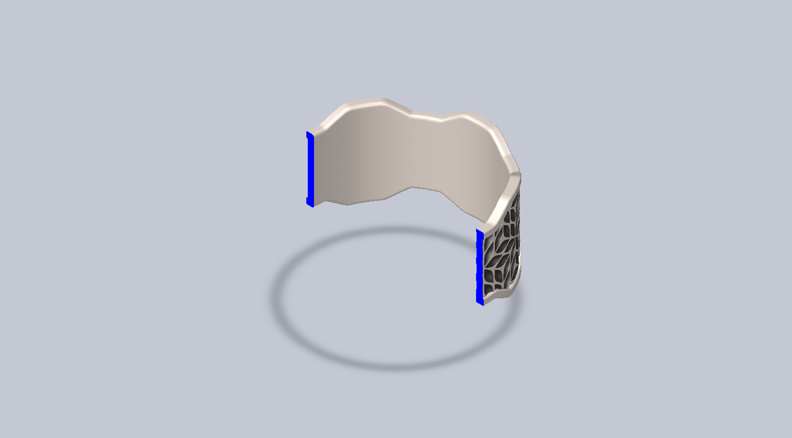

# Computational Design of Leaf Pattern on Ring

## Summary

## Design Motivation

| Name | Image |
| :--: | :---: |

## CAD Design

|   View    |                               Image                               |
| :-------: | :---------------------------------------------------------------: |
| Isometric |  |
|   Left    |            |
|   Right   |          |
|   Back    |            |
|   Front   |          |
|    Top    |              |
|  Bottom   |        |
|  Section  |      |

## Technologies Used

| Purpose |               Name                |
| :-----: | :-------------------------------: |
| Design  | SolidWorks 2024 (Student Version) |

## Applications

## Design Limitations

## Future Improvements

## References
