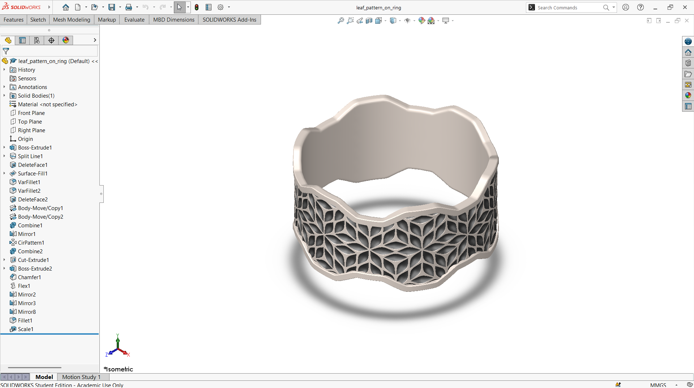

# A Wide Wavy-Edged Ring with an Engraved Leaf-Star Pattern

## Summary

Rings are one of the oldest and most personal forms of jewelry, and surface patterns are what give each one its character. Leaves are a popular motif because they are simple, natural, and easy to repeat. This project explores how a leaf-inspired pattern can be arranged around a wide ring band.

The ring is a wide band with a gently wavy top and bottom edge, so the outline of the ring itself looks soft and organic. The outer surface carries a repeating pattern of pointed, petal-like leaves that meet around central points and form star-shaped clusters. The pattern is recessed into the surface, which creates a contrast between the raised metal and the deeper engraved areas, while the inner surface is left smooth for comfort. The main challenge was to make the leaf clusters repeat evenly around the curved band so that the pattern closes without gaps or uneven spacing.

The ring was developed as a computational model in SolidWorks. The views below show the band, the wavy edge, and the leaf pattern from every side, along with a section view that shows the thickness of the ring. This prototype is a base concept design that can be developed further into a real piece of jewelry.

---

## Computational Design

|   View    |                               Image                               |
| :-------: | :---------------------------------------------------------------: |
| Isometric |  |
|   Left    |            |
|   Right   |          |
|   Back    |            |
|   Front   |          |
|    Top    |              |
|  Bottom   |        |
|  Section  |      |

---

## Software Used

| Purpose |               Name                |
| :-----: | :-------------------------------: |
| Design  | SolidWorks 2024 (Student Version) |

---

## Tools Used

| No  |       Name       |
| :-: | :--------------: |
| 01  |   Boss Extrude   |
| 02  |    Split Line    |
| 03  |   Delete Face    |
| 04  |   Surface Fill   |
| 05  | Variable Fillet  |
| 06  |  Body Move/Copy  |
| 07  |     Combine      |
| 08  |      Mirror      |
| 09  | Circular Pattern |
| 10  |     Chamfer      |
| 11  |       Flex       |
| 12  |      Mirror      |
| 13  |      Fillet      |
| 14  |      Scale       |

---

## Image of the Tool Used

---

## Applications [^1][^2]

- Wedding Bands
- Engagement Ring Settings
- Promise Rings
- Everyday Nature-Inspired Jewelry
- Couples' Matching Ring Sets
- Custom Made-to-Order Jewelry

---

## Design Limitations

The design of the ring was developed as a prototype product. That’s why the real-life design considerations, including ring-size standards, metal selection, wall thickness for casting, comfort, hallmarking, proper design specification, monetization, and feasibility, have not been included.

---

## Future Improvements

The leaf pattern was modeled by hand on the ring band, so it is difficult to change the leaf size, count, or spacing. A parametric pattern or an automated wrap tool would make sizing and design variations much easier. Real jewelry also needs ring-size standards, a metal selection (yellow, white, or rose gold or platinum), and a decision on setting or engraving depth. The model could also be prepared for casting or 3D printing in wax and checked for minimum wall thickness.

---

## References

[^1]: [Leaf engagement rings](https://www.gabrielny.com/engagement-rings/leaf)

[^2]: [Leaf and Vine Wedding Rings](https://krikawa.com/unique-wedding-bands/nature-rings/leaf-wedding-rings)

---

## Acknowledgements

Special thanks to the [EasyCAD Solutions](https://www.youtube.com/@EasyCADSolutions) YouTube channel for the SolidWorks tutorials that helped in creating this design.
